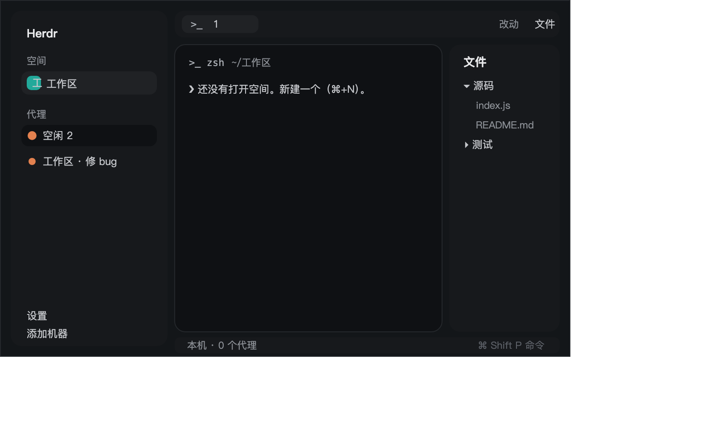

# Herdr 中文界面

Herdr 的界面只有英文，也没有地方能改语言。这个仓库把它换成中文，做法是一份中文布局，加上二十多个改过文案的界面模块。

Herdr 的程序本体一行没动，也没有重签名。装完按 ⌘,，设置页就是中文的。



截图是 Herdr 0.1.10 上抓的真实窗口，没有加工。

## 为什么得这么改

Herdr 没有语言选项，界面文字要么写死在程序里，要么写死在各个界面模块里。能改的只有后者，而模块有一堆，所以这个仓库就是把它们一个个译过来。

它每次启动会把自己附带的布局和模块重写一遍。所以中文不能改在原文件上，得放在副本里（`mods/*-zh/` 和 `layouts/main-zh.json`）。装法也只能是复制文件过去，别指望装一次就一劳永逸。

设置窗口、关闭确认框、重命名输入框更麻烦一点。它们的源码也在这个目录里，但没有副本可用，只能原地换成中文，再用文件锁挡住重写。做法见下面「设置窗口」。

agent 的预览条（peek）和系统提示条（toast）换不了。Herdr 是按固定名字打开这两个的，用户这边没有配置项，那两处还是英文。

## 安装

```sh
git clone https://github.com/yzj160212/herdr-zh.git ~/herdr-zh
cd ~/herdr-zh

mkdir -p ~/.config/herdr-app/layouts ~/.config/herdr-app/mods
cp -R layouts/* ~/.config/herdr-app/layouts/
cp -R mods/*    ~/.config/herdr-app/mods/
```

（`~/.config/herdr-app` 是 Herdr 自己放布局和模块的目录，也就是它自带文件待的地方。）

再合并按键。仓库里的 `keys.json` 有六项，加到你自己 `keys.json` 的 `global` 段里。不要整份覆盖，不然你自己的按键就没了。

| 按键 | 打开 |
| --- | --- |
| ⌘, | 中文设置页 |
| ⌘⇧P | 中文命令面板 |
| ⌘/ 或 ⌘⇧/ | 中文快捷键页 |
| ⌘P | 中文跳转面板 |
| F2 | 重命名标签页 |
| ⇧F2 | 重命名空间 |

最后切到中文布局：

```sh
herdr-app do layout.switch '{"name":"main-zh"}'
```

这里的 `herdr-app` 是 Herdr 自带的命令行工具，装应用的时候就有了，不用另外安装。它后面接子命令：`do` 执行一条命令（比如切布局），`check` 试着加载一个模块看有没有报错，`status` 看当前布局和错误，`shot` 存一张窗口截图。

想切回英文，把 `main-zh` 换成 `main` 就行。删掉 `layouts/main-zh.json` 和 `mods/*-zh` 就彻底干净了。

## 设置窗口

Herdr 的设置窗口是独立窗口，源码在 `frame/settings/`，每次启动都会被重写。改法是写成中文版之后把文件锁住，它写不进去就跳过：

```sh
cp -R tools ~/.config/herdr-app/zh-patch
cd ~/.config/herdr-app

./zh-patch/apply.sh             # 换中文
./zh-patch/apply.sh --restore   # 换回英文
./zh-patch/apply.sh --status    # 看看还锁着没有
```

`apply.sh` 会顺手处理关闭确认框（`mods/confirm`）和重命名输入框（`mods/prompt`），它们的情况一样。

`chmod 444` 和 `chflags uchg` 是 macOS 上两种"只读"的标记：前者把写权限去掉，后者加上不可变标志。两个一起用，Herdr 才写不进去。

代价是这三个文件从此不跟 Herdr 的更新走。升级后如果设置页缺了新版本才有的选项，重跑一次 `apply.sh`；要是新版本改了源码结构，就得按 `UPGRADE.md` 里的办法把中文搬到新版上去。

## 里面有什么

两个布局：

| 文件 | 说明 |
| --- | --- |
| `layouts/main-zh.json` | 主布局。左边空间和代理列表，上面标签栏，右边文件与改动面板，底下状态栏，中间终端 |
| `layouts/terminals-zh.json` | 终端版布局。标签放在标题栏，窗格做成卡片 |

二十五个模块：

| 位置 | 模块 | 中文的部分 |
| --- | --- | --- |
| 布局 | `workspace-chrome-zh` | 顶上的 Herdr 一行，底下的「设置」「添加机器」 |
| 布局 | `spaces-zh` | 「空间」标题、空间名、按机器分组、右键菜单 |
| 布局 | `agents-zh` | 「代理」标题、按优先级或空间分组、置顶、子代理树、四种状态的显示 |
| 布局 | `tabs-zh` | 标签栏、「文件」「改动」按钮、＋菜单 |
| 布局 | `pane-zh` | 窗格表头：程序名、路径、状态、分屏与关闭按钮 |
| 布局 | `workspace-status-zh` | 状态栏：「本机 · N 个代理」和「⌘ Shift P 命令」 |
| 布局 | `files-zh` | 「文件」面板、目录树、只读预览、出错提示 |
| 布局 | `changes-zh` | 「改动」面板、diff、提交框 |
| 空状态 | `empty-zh` | 「还没有打开空间。新建一个（⌘+N）。」，以及一个新建按钮 |
| 浮层 | `menu-zh` | 右键菜单，窗格、标签、空间各一套，加四个主题 |
| 浮层 | `new-menu-zh` | ＋菜单：终端、启动一个代理、新建空间、worktree |
| 浮层 | `picker-zh` | 跳转面板，列出空间、标签和其中的代理 |
| 浮层 | `machine-add-zh` | 「添加机器」，从 ssh 配置列主机，Mac 上还有授权说明 |
| 浮层 | `worktree-zh` | 新建、打开、移除 worktree |
| 浮层 | `help-zh` | 快捷键页，命令名也译成中文 |
| 浮层 | `prompt-zh` | 输入框：名称、取消、保存 |
| 浮层 | `rename-tab-zh` `rename-space-zh` | 双击标签或右键空间，直接弹中文重命名框 |
| 窗口 | `settings-zh` | 设置页：外观、机器、提醒、更新、隐私 |
| 窗口 | `palette-zh` | 命令面板 |
| 窗口 | `feedback-zh` | 发送反馈 |
| 窗口 | `welcome-zh` | 欢迎页 |
| 窗口 | `whatsnew-zh` | 更新内容 |
| 终端版 | `terminals-bar-zh` `terminals-pane-zh` | 终端版布局的标题栏和窗格表头 |

`peek-zh` 和 `toast-zh` 其实也译好了，但没放进这个仓库，原因就是上面那条。

## 已知改不了的

macOS 菜单栏里 Herdr 菜单的那几项，`Settings…`、`Hide Herdr`、`Quit Herdr`、`Services`、`Show All`，文字在程序里，换不了。其中 `Settings…` 打开的是中文设置页。

程序自己弹的提示条，比如 "herdr-core is up to date"，文字也在程序里。

终端里你自己程序输出的内容当然不算界面。

有意留英文的专有名词：`Herdr`、`Herdr 98`、`herdr-core`、`hc`、字体名（JetBrains Mono、Geist）、主题名（graphite、ink、moss、atom one dark、paper），还有 `Esc`。

## 升级之后

Herdr 升级会把它自己的文件换掉，中文会有几处回退。`tools/` 里有体检和跟版的工具，怎么用写在 `UPGRADE.md`。

## 许可

Apache-2.0。这些模块是 Herdr 自带模块改出来的衍生作品，署名和图标来源（Lucide，ISC）写在 `NOTICE`。完整的复刻说明在 `RECIPE.md`。
