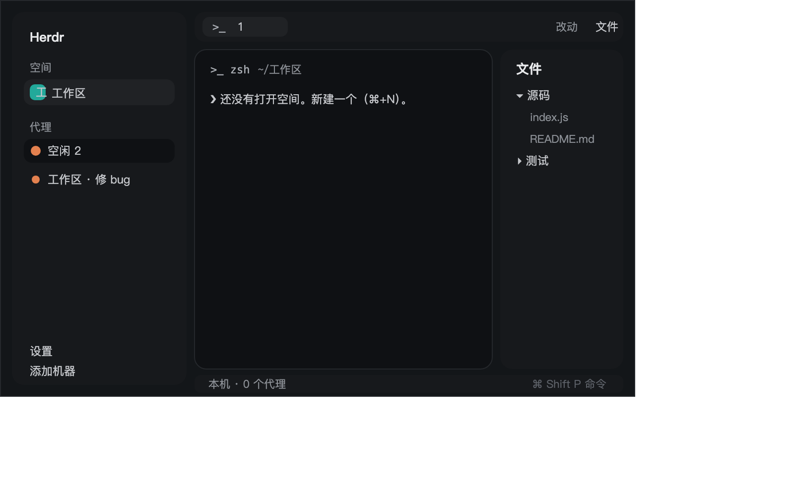

# Herdr 中文版

把 Herdr 的界面换成简体中文：侧边栏、代理列表、标签栏、窗格表头、文件/改动面板、
状态栏、右键菜单、＋菜单、跳转面板、添加机器、worktree、快捷键页、设置页、
命令面板、反馈、欢迎页、更新内容，以及「没有打开空间」时的空状态。
另附一个中文的终端版布局。不改 `Herdr.app` 本体，不动二进制，不重签名。



---

## 你会看到什么

**`layouts/main-zh.json`（Herdr 中文版）**，从左到右、从上到下：

- 根节点 `root`：`row`，`titlebar: none`（不画系统标题栏），`traffic_lights: [12, 16]`，
  `background: canvas`，`terminal_padding: [14, 12]`，`divider: {width:1, color:border}`，
  `terminal_menu: menu-zh`。**不设 `theme`/`font`**，所以配色与字体来自用户的 `settings.json`。
- `sidebar`（`column`，268px，min 44，max 480，`background: chrome`，`resizable: false`）：
  - `brand`（46px 高，`window_drag: true`）→ `workspace-chrome-zh`：羊头图标 + `Herdr`、
    放大镜、侧边栏开关。
  - `sidebar-lists`：`spaces`（weight 1，min 90）→ `spaces-zh`；
    `agents`（weight 1，min 90）→ `agents-zh`。中间一条 1px 分隔线。
  - `sidebar-footer`（69px 高）→ `workspace-chrome-zh` 带 `props.footer: true`：
    「设置」「添加机器」两行，去掉了图标键。
- `work`（`column`，`resizable: false`）：
  - `tabs`（42px 高，`window_drag: true`）→ `tabs-zh`：标签胶囊 + ＋按钮 +
    「文件」「改动」两个面板按钮（macOS 上还有最小化/最大化/关闭）。
  - `work-body`（`row`，`padding: 8`，`gap: 8`）：
    - `main-stack`（`stack`，`active: "terminals"`）：
      - `terminals` → `{ "tab": "active" }`，`pane` 设 `radius: 10`、
        `header: {content:{mod:"pane-zh"}, height:30, position:"top", reveal:"always"}`、
        `border: {1, border}`、`focus: {1, accent}`、`gap: 8`、`lone: true`。
      - `empty` → `empty-zh`：没有空间时显示中文空状态，见「它怎么表现」。
    - `panel`（`column`，368px，min 280，max 900，**`hidden: true`**）：
      `panel-body`（`stack`，`active: "files"`）里 `files` → `files-zh`、
      `changes` → `changes-zh`。由标签栏的两个按钮开关。
  - `status`（28px 高）→ `workspace-status-zh`。

**`layouts/terminals-zh.json`（终端版 中文）**：根节点自带调色板
（`#131619` 背景、`#3b82f6` 强调色、`graphite` 主题、`font_size: 15`、`padding: [6,6]`、`gap: 8`），
`traffic_lights: [16, 18]`。顶部 `tabs`（38px，`window_drag: true`）→ `terminals-bar-zh`
（空间胶囊 + 标签 + 窗口按钮 + 命令/新建按钮）；`main` → `{tab:"active"}`，
`pane.header` → `terminals-pane-zh`（深色系硬编码的窗格表头）。

字号都不是新加的：中文文字用各模块原本的 `text_size`（例如状态栏 11.8、菜单 12.8、
代理行 13、文件行 13），CJK 字形由系统字体（macOS 上是苹方）补上。

**中文化到什么程度**：所有 Herdr 自带的用户可见英文都译了，包括命令名在快捷键页里
也译成中文（`space.new` → 新建空间）。保留英文的只有专有名词：`Herdr`、`Herdr 98`、
`herdr-core`、`hc`、字体名（`JetBrains Mono`、`Geist`）、主题名
（`graphite` `ink` `moss` `atom one dark` `paper`）、以及快捷键名 `Esc`。

---

## 它怎么表现

**空间列表（`spaces-zh`）**：标题行 31px 高，左内边距 16px、右 10px，写「空间」，
右侧一个 ＋ 打开新建空间。每个空间一行 30px 高（worktree 子行 28px）、圆角 8、
左右内边距 8；行首是 18px 的圆角色块（5px 圆角、按下标取的调色板色 `ansi6/ansi3/ansi4/ansi5/ansi2/ansi1`），
里面是空间名首字。名后只在"不寻常"时才跟 `仓库 · 分支 ↑2 ↓1`（主分支、与空间同名的分支不显示）。
单击选择（`space.select`），按下再拖到别的行则排序（`space.move`），右键在指针处弹 `menu-zh`
（200×260，`props: {tab:"space", target:{id}}`）。侧边栏宽度小于 **160px** 时自动变窄栏：
只显示序号 + 一个状态点（`●` 需要你 / `·` 其他）。已知机器不止一台时，列表按机器分组，
每组 26px 高的标题（小显示器/服务器图标 + 机器名 + ＋ + 折叠箭头「载入中…」）。

**代理列表（`agents-zh`）**：标题「代理」41px 高，右上角一个排序按钮，点开 `agents-zh`
自身的弹出菜单（200×140，`props: {sortMenu:true}`），两种排法：**按优先级** 或 **按空间分组**。
按优先级时分组标题是「需要你 / 已完成 / 进行中 / 空闲」，按空间时用空间名，标题 30px 高、
11px 灰字、可点击折叠（折叠后显示数量与最紧急状态）。每个代理一行 30px 高、圆角 8、
圆点距 9；聚焦的那行用 `selected` 底色。四种状态：

| 状态 | 行尾/标题里的样子 |
|---|---|
| `working` 进行中 | 12px 转圈图标（`spinner.svg`，900ms 一圈） |
| `blocked` 需要你 | 胶囊：`blocked` 色 + 15% 透明度底、10.5px 半粗字，写「需要你」 |
| `done` 已完成 | 7px 实心圆点，`done` 色 |
| `idle` 空闲 | 7px 空心圆环，1.5px 边框，`idle` 色（缺省 `dim`） |

悬停在行上，右侧出现图钉按钮（`tooltip` 是「置顶」/「取消置顶」），置顶的代理排到最前并
在优先级视图里额外用 `· 细节` 标出空间名。子代理以树形缩进（`└`/`├` 用 1.5px 边框画），
点一下预览（`terminal.peek`）。点击代理行聚焦它的窗格（`pane.focus`）。空闲时间显示
`<1m` / `3m` / `2h` / `5d`。列表为空时显示「还没有代理状态。代理上报状态后才会出现在这里。
旧版本和在 tmux 里运行的代理可能不会显示。」

**标签栏（`tabs-zh`）**：每个标签 29px 高、圆角 7、内边距左右 10，激活的用 `raised` 底 +
`border` 边，其余透明。标签名最长 170px 后省略；程序图标 14px（单色字形或图片）。
双击改名 → 打开中文重命名框；拖动排序（`tab.move`）；右键弹 `menu-zh`（`props: {tab:"tab"}`）；
激活标签右端有 ✕（`tab.close`）。＋按钮打开 `new-menu-zh`（250×512）。右侧
「文件」「改动」两个按钮开关 `panel` 列，并记住每个空间各自的选择。

**窗格表头（`pane-zh`）**：30px 高，左右内边距 10、圆点距 8。程序图标 14px、名称最多 260px、
然后是 `~` 缩写后的目录；行尾按状态显示转圈 / 「需要你」胶囊 / 完成圆点。
鼠标悬停在表头上时浮现四个 14px 图标按钮：向右分屏、向下分屏、放大/还原、关闭。

**状态栏（`workspace-status-zh`）**：28px 高、左右内边距 14、圆点距 16、11.8px 灰字。
从左到右：`本机`（或远端机器名，带服务器图标）· 当前分支 · `● N 个代理`
（有阻塞时追加 `· N 个需要你`，用 `blocked` 色）· 空白 · 右侧 `⌘ Shift P  命令`，
点击打开 `palette-zh`。

**文件面板（`files-zh`）**：标题栏 42px 高，「文件」标题 + 右侧当前目录名；打开文件后
标题变成文件名 + 一个 ← 返回。目录树每行 28px、每层缩进 18px、圆角 7，文件夹可展开
（懒加载），git 状态在行尾标 `A`/`M`/`D`/`U`（绿/红/橙）。预览用只读编辑器，
语法高亮取主题色（`ansi5` 关键字、`ansi2` 字符串、`ansi4` 函数、`ansi3` 类型、`ansi1` 数字、`ansi6` 常量）。
上限：每层 500 条、总计 5000 条（超出时提示「文件列表上限：每个文件夹 500 项，共 5,000 项」）；
文件超过 400000 字截断并注明「（文件已截断）」；目录变动 10 秒轮询 + 文件夹监视。

**改动面板（`changes-zh`）**：标题栏 42px，「改动」+ `N 个文件` + `+N −N`。文件列表最多 200px 高、
每行 28px（状态字母 + 路径 + 增删数），点开后下方是统一 diff：虚拟列表、每行 20px，
新增行用 `ansi2` 18% 底、删除行用 `ansi1` 18% 底，行号 30px 宽右对齐。底部是提交框
（32px，输入 12px）+「提交」按钮（有内容时才点亮）。上限 1000 个文件、每文件 1500 行、
每行 4000 字符。

**空状态（`empty-zh`）**：Herdr 内建的那句 `No space open. Make one (cmd-n).` 是硬编码英文，
换不掉，所以用一个**整块的 stack 子节点盖住它**：`main-stack` 的 `empty` 子节点渲染一个
圆角 12、`chrome` 底的卡片，写「还没有打开空间。新建一个（⌘+N）。」，下面一个
「新建空间」按钮（`space.new`）。`empty-zh` 每 700ms 检查一次：有空间就把 stack 切回
`terminals`，没有就切到 `empty`（`layout.select`）。所以运行中打开/关闭最后一个空间，
画面会自动切换，不需要手动切布局。

**浮层（都开在指针处或顶部）**：

| 浮层 | 尺寸 | 内容 |
|---|---|---|
| `menu-zh` | 200×260（空间）/ 200（标签、窗格） | 窗格：向右分屏、向下分屏、放大此窗格、右键交还给 Herdr 菜单 / 右键直接交给窗格程序、收回到父代理、关闭窗格；标签：重命名、新建标签页、关闭；空间：重命名、新建/打开/移除 worktree、关闭；空白处：新建空间、快捷键、四个主题 |
| `new-menu-zh` | 250×512（高 = 167 + 31×项数，最多 491） | 终端、启动一个代理（已安装的全部 + 未安装的最多 2 个，带 ⌘T / ⌘1…9 与「未安装」）、新建空间、新建 worktree…、打开 worktree… |
| `picker-zh` | 顶部偏移 40，640 宽，0.8 高 | 「跳转到…」：按空间分组，列出标签与其中的代理（转圈/●/○/`·` + 「需要你」「已完成」），空闲空间折进「更早的：N 个空闲空间」；末尾是「新建标签页」和各机器上的「新建空间」。↑↓ 选、↵ 去、ctrl+d 关掉该标签、esc 关 |
| `machine-add-zh` | 560 宽对话框；需要回答时再开一个 640×300 的窗口 | 「添加机器」：从 `~/.ssh/config` 列出的主机（每行 40px +「添加」按钮）、手输 `user@host`、added 后显示「已添加」「连接中」「在它的终端里等待」；目标是 Mac 时给一张完全磁盘访问权限的说明卡；需要输入密码/主机指纹时在窗口里附一个终端 |
| `worktree-zh` | 440×260（新建/移除）、560×480（打开） | 新建：分支名输入 + 「↵ 创建 · esc 取消」；打开：检出列表（每行 44px，标「主检出」「已打开」）+ 过滤框 + 「↑↓ 选择 · ↵ 打开 · esc 关闭」；移除：确认 + 未提交改动/未推送子模块的警告 |
| `help-zh` | 默认弹窗 | 「快捷键」：输入框筛选，按「空间 / 标签页 / 窗格 / 代理 / 终端 / 窗口与其它」分组，左列 190px 显示按键、右列显示中文动作名 |
| `prompt-zh` | 380 | 「名称」+ 输入框 + 取消/保存（Enter 保存、Esc 取消） |
| `rename-tab-zh` / `rename-space-zh` | 380 | 打开即预填当前名并弹出 `prompt-zh`，直接调 `tab.rename` / `space.rename` |
| `settings-zh` | 760×620 | 五节：外观（布局/主题/跟随系统·浅色·深色/缩放/终端字体/界面字体）、机器（本机 + 远端，更新/重命名/移除/添加机器）、提醒（播放声音 + 两种音效试听）、更新（Herdr 与 herdr-core 的检查/重启更新）、隐私（匿名使用数据开关 + 会发送什么） |
| `palette-zh` | 顶部偏移 60，640 宽，0.7 高 | 「命令面板」：10 行×32px 的列表、分组标题 26px，分组是「最近使用 / 标签页 / 窗格 / 空间 / 布局 / 终端 / 代理 / 窗口 / 应用」，模糊搜索同时匹配中文标题与关键词 |
| `feedback-zh` | 640 | 「发送反馈」：留言、邮箱（可选）、最多 3 张截图、将要发送的 JSON、取消/发送 |
| `welcome-zh` | 760×640 | 「欢迎使用 Herdr」四页引导，中文 |
| `whatsnew-zh` | 640×620 | 「Herdr 更新内容」 |

**键位入口**（`keys.json`）：`⌘,` 中文设置 · `⌘⇧P` 中文命令面板 · `⌘/` 与 `⌘⇧/` 中文快捷键 ·
`⌘P` 中文跳转 · `F2` 重命名标签页 · `⇧F2` 重命名空间。

---

## 由什么搭成

**布局**：`layouts/main-zh.json`（克隆自 Herdr 自带 `layouts/main.json`，根节点
`cloned_from: {name:"main"}`）与 `layouts/terminals-zh.json`（克隆自 `terminals.json`）。
节点树与尺寸见上一节；两个布局都只是**换掉 `content.mod` 指向的模块名**，结构与自带版一致。

**每个模块用什么搭的**：

| 模块 | props 角色 | 调用的 herdr API | 调用的命令 |
|---|---|---|---|
| `workspace-chrome-zh` | `{footer:true}` 画底部两行 | `theme, props, run, shared, setShared, updates, window, layout` | `layout.resize`、`mod.open` |
| `spaces-zh` | 无 | `spaces, machines, panes, exec, hc, theme, watchFolder, shared, setShared, openOverlay, layout, window` | `space.new/select/move` |
| `agents-zh` | `{sortMenu:true}` 只要排序菜单 | `agents, terminals, panes, focused, spaces, theme, shared, setShared, setAgentOrder, openOverlay, closeOverlay, window, layout` | `pane.focus`、`terminal.peek`、`layout.resize` |
| `tabs-zh` | 无 | `spaces, panes, run, openOverlay, theme, window, shared, layout, settings` | `tab.select/move/close`、`layout.show/hide/select`、`mod.open`、`window.*` |
| `pane-zh` | `{pane}`（由 `pane.header` 传入） | `panes, props, run, theme, home` | `pane.focus/split/zoom/close` |
| `workspace-status-zh` | 无 | `spaces, agents, theme, window` | `mod.open` |
| `files-zh` | 无 | `spaces, panes, focused, exec, readTextFile, watchFolder, theme, settings, window` | 跑 `sh`/`powershell` 列目录、`git rev-parse/status` |
| `changes-zh` | 无 | `spaces, panes, focused, exec, readTextFile, watchFolder, theme, settings` | 跑 `git status/diff/numstat/add/commit` |
| `empty-zh` | 无 | `spaces, theme, window, run, layout` | `layout.select`、`space.new` |
| `menu-zh` | `{tab, target, overlay}` | `run, props, closeOverlay, openOverlay, theme, keys, terminals, spaces, panes, exec` | 右键菜单里的各项 |
| `new-menu-zh` | `{overlay, space?}` | `theme, spaces, panes, knownAgents, run, openOverlay, closeOverlay, props, window, keys` | `tab.new`、`space.new` |
| `picker-zh` | `{overlay}` | `agents, spaces, terminals, run, hc, theme, props, closeOverlay, openOverlay, shared, setShared` | `tab.select/new/close`、`space.new` |
| `machine-add-zh` | `{part:"bar", target}` 只要标题栏 | `hc, exec, home, readTextFile, theme, props, closeOverlay, openOverlay` | `hc machine ls`、`hc machine add`、`hc run --bg`、`open x-apple.systempreferences…` |
| `worktree-zh` | `{space, folder?, action:"new"\|"open"\|"remove"}` 或 `{branch, tab?, argv?}` | `spaces, panes, exec, home, theme, props, closeOverlay, run` | `space.new/select/close`、`git worktree/rev-parse/for-each-ref` |
| `help-zh` | `{overlay}` | `keys, props, closeOverlay, theme` | — |
| `prompt-zh` | `{title, hint, value, command:{name,args}, overlay}` | `run, props, closeOverlay, theme` | 由 `command` 指定 |
| `rename-tab-zh` / `rename-space-zh` | 无 | `spaces, openOverlay, closeOverlay, props` | 转手给 `prompt-zh` |
| `settings-zh` | `{section?}`、`{overlay}` | `appHome, fonts, themes, layouts, updates, telemetry, settings, shared, readTextFile, writeTextFile, playSound, hc, theme, run, props, closeOverlay` | `app.theme`、`app.update`、`app.update_core`、`app.check_updates`、`layout.switch`、`mod.open` |
| `palette-zh` | `{overlay}` | `commands, layouts, keys, shared, run, openOverlay, closeOverlay, theme, props, window` | 表里每条命令 |
| `feedback-zh` | `{message?, from?, overlay}` | `feedbackPreview, feedbackPasteImage, feedbackPickImages, feedbackAttachImages, feedbackClearImages, sendFeedback, theme, props, closeOverlay` | — |
| `welcome-zh` | `{overlay}` | `spaces, run, theme, props, closeOverlay, setShared, shared, hc, appHome, readTextFile, writeTextFile, settings, layout, keys` | `space.new`、`layout.show/hide/select`、`mod.open` |
| `whatsnew-zh` | `{notes, overlay}` | `updates, presentUpdateNotes, theme, props, closeOverlay` | — |
| `terminals-bar-zh` / `terminals-pane-zh` | 后者用 `{pane}` | `spaces, panes, home, openOverlay, run, window, theme` | `tab.select/new`、`pane.focus/split/zoom/close`、`mod.open` |

**美术**：`mods/workspace-chrome-zh/` 里有 33 个 SVG（`spinner.svg`、`monitor.svg`、
`server.svg`、`branch.svg`、`plus.svg`、`search.svg`、`sidebar.svg`、`settings.svg`、
`chevron-*.svg`、`x.svg` 等），`files-zh/` 4 个，`pane-zh/` 5 个，`tabs-zh/` 4 个
（Windows 窗口按钮），`palette-zh/command.svg`，`settings-zh/` 6 个，`welcome-zh/` 7 个。
都是 Herdr 自带图标（Lucide / Feather 衍生，见 NOTICE），原样复制过来。

**`tools/`（可选）**：`apply.sh` 把 `frame/settings/main.js`、`mods/confirm/main.js`、
`mods/prompt/main.js` 换成中文并锁定；`verify.sh` 体检；`refresh.sh` + `zhmerge.py`
在 Herdr 升级后把中文搬到新版上游；`leftover.py` 扫残留英文；
`frame-settings-en.js` / `mods-confirm-en.js` / `mods-prompt-en.js` 是 Herdr 原文件的副本。

---

## 当心

- **Herdr 每次启动会重写它自己的文件。** `frame/`、`mods/spaces`、`mods/agents`、`mods/tabs`、
  `mods/menu`、`mods/prompt` … 全都会被二进制内嵌的源码覆盖，编辑它们会留下 `*-edited` 副本
  然后被还原。所以中文**必须**放在自建副本（`*-zh`）里。唯一的例外是设置窗口、确认框、
  重命名框：那三个只能"锁定替换"（写入中文后 `chmod 444` + `chflags uchg`）。
  只加 `chflags uchg` 不够，**两个都要**。
- **别整份覆盖 `keys.json`。** 用户自己的键位在里面，只合并那六项。
- **`mod.clone` 只处理"自己的"引用。** 它会改写本模块的资源路径（`mods/pane/` →
  `mods/pane-zh/`）和"自开浮层"的名字，但**跨模块引用要手工改**：例如 `spaces-zh` 里
  `openOverlay({mod:"menu"})` 要改成 `menu-zh`，`tabs-zh` 要指向 `menu-zh`/`new-menu-zh`。
  漏改的结果是弹出一个英文菜单，而不是报错 —— 很容易漏。
- **`peek` 和 `toast` 换不了。** Herdr 按固定名字 `peek` / `toast` 打开这两个，
  用户侧没有配置项（`terminal_menu` 只影响终端右键菜单）。这两处仍是英文。
- **空状态靠"盖"不靠"删"。** Herdr 内建的空状态文案在二进制里，只能用一个覆盖整块的
  stack 子节点盖住；这也是为什么 `main-zh` 的 `main` 位置是个 `stack` 而不是直接
  `{tab:"active"}` 的 block。若把 `main-stack` 改名或改成别的结构，`empty-zh` 就找不到它、
  什么也不做（不报错），此时会露出内建的英文。
- **`empty-zh` 用 700ms 定时器切换 stack 子节点。** 这是本套里唯一"轮询"的地方
  （判断 `spaces().length`）。改慢一点（如 2000ms）画面切换会有延迟，改快没必要。
- **侧边栏窄于 160px 会变成窄栏**（`spaces-zh`/`agents-zh` 按宽度判断，不是标志位），
  这是 Herdr 自带行为，中文版保留了：窄栏下 `agents-zh` 只显示序号 + 一个状态符号，
  文案基本看不见。
- **状态值大小写**：`agents()`/`machines()` 给的状态词可能是 `connected` 也可能是
  `Connected`，做词表时要大小写不敏感（`settings-zh` 里就是这么做的）。
- **`settings-zh` 是"独立副本"**，它跟 `frame/settings` 是两份代码。想改设置页文案时
  两处都要改（`mods/settings-zh/main.js` 和 `tools/frame-settings-zh.js`）。
- **字体**：中文靠系统的 CJK 字体补字形（macOS 是苹方）。如果用户把 `ui_font`
  设成一个没有 CJK 的字体，Herdr 仍会回退到系统字体，一般不会出方块。
- **预览 SVG 是纯图形**（`layouts/*.svg`），因为 Herdr 自带的 `win98.svg` 也是纯图形、
  渲染器不保证支持 `<text>`。要看带中文标签的图，看 `preview.png`（由
  `assets/*.svg` 经 Chrome 无头渲染生成）。
- **还没生效的控件**：`welcome-zh` 的「外观」分段控件会写 `settings.json`；
  非 macOS 上 `settings-zh` 的「完全磁盘访问权限」按钮无意义（那是 macOS 特有）。
  `palette-zh` 表里个别命令在旧版本上不存在，会自动被 `commands()` 过滤掉，不会报错。

---

## 算完成的条件

装好之后，下面每一条都能真做到，就说明这套东西是好的（Herdr 0.1.10 上已逐条跑过）：

```sh
H=~/.config/herdr-app
cp -R layouts/* "$H/layouts/"; cp -R mods/* "$H/mods/"

# 1. 每个模块都能加载（25 个，全部通过）
for d in "$H"/mods/*-zh "$H"/mods/empty-zh "$H"/mods/rename-tab-zh "$H"/mods/rename-space-zh; do
  herdr-app check "$d" | tail -1
done

# 2. 两个布局都能切，且没有报错
herdr-app do layout.switch '{"name":"main-zh"}'; sleep 2
herdr-app status | python3 -c 'import json,sys; d=json.load(sys.stdin); print(d["layout"], d["errors"])'
# 期望：main-zh []
herdr-app do layout.switch '{"name":"terminals-zh"}'; sleep 2
herdr-app status | python3 -c 'import json,sys; print(json.load(sys.stdin)["errors"])'
herdr-app do layout.switch '{"name":"main-zh"}'

# 3. 目视：截图里侧边栏是「空间 / 代理 / 设置 / 添加机器」，
#    状态栏是「本机 · N 个代理」和「⌘ Shift P 命令」
herdr-app shot /tmp/zh.png

# 4. 空状态：关掉所有空间后，中间显示
#    「还没有打开空间。新建一个（⌘+N）。」+「新建空间」按钮，而不是英文那句
herdr-app do space.close --id <最后一个空间> --confirmed true; sleep 2; herdr-app shot /tmp/zh-empty.png
# 点「新建空间」后自动切回终端画面（不用手动切布局）

# 5. 浮层（打开后看是不是中文）
herdr-app do mod.open '{"name":"palette-zh"}'        # 命令面板
herdr-app do mod.open '{"name":"settings-zh"}'       # 设置页
herdr-app do mod.open '{"name":"help-zh"}'           # 快捷键
herdr-app do mod.open '{"name":"machine-add-zh"}'    # 添加机器

# 6. 装过 tools/ 之后（可选）：一键体检 8 项全绿
cd "$H" && ./zh-patch/verify.sh
```

界面本身也要看到：侧边栏四个中文标题、标签栏「文件」「改动」、
右键菜单全中文、`F2` 弹中文重命名框、`⌘,` 弹中文设置页并五个分节都是中文。
</DOC
wc -l RECIPE.md; head -12 RECIPE.md
